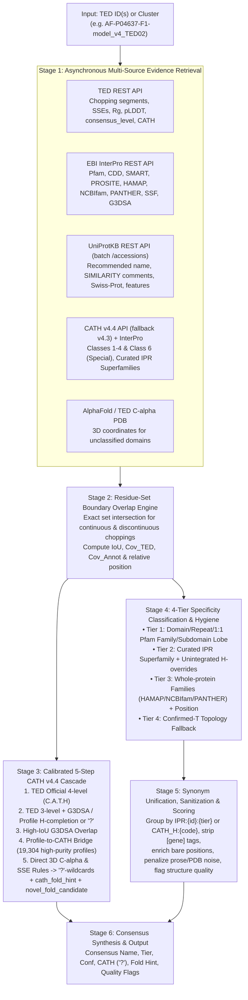

# TED Domain Naming Methodology (`ted-namer`)

This document provides the complete technical and biological methodology implemented in [`ted-namer`](https://github.com/KarelBerka/TED-namer), aligned with **TED** (*Lau et al., Science 2024*), **CATH v4.4** (*Waman et al., NAR 2025*), **InterPro 2025** (*Blum et al., NAR 2025*), and **Pfam AI/ML** (*Paysan-Lafosse et al., NAR 2025*).

---

## 1. Introduction: The TED Naming Challenge

**The Encyclopedia of Domains (TED)** ([`ted.cathdb.info`](https://ted.cathdb.info)) catalogs over 365 million structural domains segmented across the AlphaFold Protein Structure Database (AFDB) using consensus deep-learning choppers (Merizo, Chainsaw, UniDoc). Across CATH v4.4, ~90 million TED domains were integrated into CATH, introducing Class 6 (`Special`) alongside hundreds of new architectures and superfamilies while emphasizing that unmapped TED folds remain **hypothetical novel folds** until experimentally validated.

However, TED identifies domains solely by positional numeric identifiers (e.g., `AF-P04637-F1-model_v4_TED02`).

### Six Core Challenges Solved by `ted-namer`
1. **1D Sequence vs. 3D Structural Boundary Discrepancies**: Sequence HMMs (Pfam, CDD, SMART) and 3D choppers (TED) rarely share identical endpoints, and many 3D domains are **discontinuous** (`1-146_284-319`).
2. **Multi-Lobe Domain Splitting**: 3D choppers frequently split canonical sequence domains (such as eukaryotic protein kinases or Cytochrome P450s) into N-terminal and C-terminal structural lobes, causing naive Jaccard thresholds ($\text{IoU} \ge 0.35$) to miss both lobes.
3. **Unintegrated Legacy `G3DSA` PDB Headers & Boost Inflation**: While CATH v4.4 integrated many superfamilies with InterPro, high-frequency superfamilies such as `G3DSA:3.30.200.20` (*"Phosphorylase Kinase; domain 1"*) and `G3DSA:1.10.510.10` (*"Transferase(Phosphotransferase) domain 1"*) carry 1990s PDB crystal headers when unintegrated, and naive `cath_h` scoring can let them outrank specific Tier 1 domain names.
4. **`annotation_type` Conflation & Naming Noise**: Whole-protein families (`HAMAP` 100% `family`, `NCBIfam` 98.1% `family`), short `PROSITE conserved_site` signatures, sentence-like UniProt `region` prose, bracketed gene symbols (`[bioU]`), and bare positional labels (`"N-terminal domain"`) degrade naming accuracy if treated blindly as standalone domains.
5. **Cross-Database Synonym Redundancy**: Synonymous `Pfam`, `CDD`, `SMART`, and `InterPro` hits must be unified under their parent InterPro entry rather than double-counted.
6. **Hypothetical Novel Folds & `T`-Level Collision**: In TED and CATH v4.4 nomenclature, `T` means a confirmed Topology-level match. Using a `T`-prefix on unmapped novel-fold heuristics risks confusion with confirmed `T`-level topology codes.

---

## 2. Six-Stage Pipeline Architecture

Given a TED domain ID, a UniProt accession, or a structural cluster of TED IDs, [`TedNamingPipeline`](../ted_namer/pipeline.py) executes six deterministic stages:

---

## 3. Stage 1: Multi-Source Evidence Retrieval

[`TedNamingPipeline._fetch_protein_bundle`](../ted_namer/pipeline.py) and `name_clusters` use WAL-backed SQLite caching ([`ApiCache`](../ted_namer/cache.py)) and UniProtKB `/accessions` 100-protein batch prefetching to query five sources concurrently:

| Source | Endpoint / Client | Extracted Evidence |
| :--- | :--- | :--- |
| **TED API** | [`TedClient`](../ted_namer/clients/ted.py) (`/api/v1/uniprot/summary/{acc}`) | Continuous/discontinuous `chopping`, `cath_label`, `cath_assignment_level`, `consensus_level` (`high`/`medium`/`low`), `num_helix`, `num_strand`, `num_turn`, `norm_rg`, `packing_density`, `plddt`. |
| **EBI InterPro** | [`InterProClient`](../ted_namer/clients/interpro.py) (`/entry/all/protein/uniprot/{acc}`) | All overlapping member database hits (`CDD`, `Pfam`, `SMART`, `HAMAP`, `NCBIfam`, `PROSITE`, `PANTHER`, `SUPERFAMILY`, `CATH-Gene3D`) with authoritative `annotation_type`, integrated `IPR` accession, and fragments. |
| **UniProtKB** | [`UniProtClient`](../ted_namer/clients/uniprot.py) (`/uniprotkb/{acc}.json`, batch `/accessions`) | Recommended protein name, gene symbol, $L_{\text{protein}}$, Swiss-Prot reviewed status, `SIMILARITY` comments, and sequence features. |
| **CATH v4.4** | [`CathClient`](../ted_namer/clients/cath.py) (`v4_4_0` primary, `v4_3_0` fallback) | Resolves Classes 1–4 and **Class 6 (`Special`)**, 3-digit Topologies ($T$, only when confirmed), and 4-digit Superfamilies ($H$, prioritizing integrated InterPro titles or curated overrides). |
| **3D Structure** | [`TedClient.get_domain_pdb`](../ted_namer/clients/ted.py) | Fetches domain $\text{C}\alpha$ coordinates only when sequence/structural profiles cannot resolve CATH (`est_source.startswith("rule_")`). |

---

## 4. Stage 2: Residue-Set Boundary Overlap Engine

Because both TED choppings and InterPro profile locations can contain discontinuous segments (`1-146_284-319`), [`ted_namer/overlap.py`](../ted_namer/overlap.py) models each as an exact integer residue set:

$$R_{\text{TED}} = \bigcup_{k=1}^{m} \{r \in \mathbb{Z} \mid s_k \le r \le e_k\}, \qquad R_{\text{Annot}} = \bigcup_{j=1}^{n} \{r \in \mathbb{Z} \mid a_j \le r \le b_j\}$$

$$\text{IoU} = \frac{|R_{\text{TED}} \cap R_{\text{Annot}}|}{|R_{\text{TED}} \cup R_{\text{Annot}}|}, \qquad \text{Cov}_{\text{TED}} = \frac{|R_{\text{TED}} \cap R_{\text{Annot}}|}{|R_{\text{TED}}|}, \qquad \text{Cov}_{\text{Annot}} = \frac{|R_{\text{TED}} \cap R_{\text{Annot}}|}{|R_{\text{Annot}}|}$$

Overlap categories (`EXACT_MATCH`, `SUB_DOMAIN`, `SUPRA_DOMAIN`, `PARTIAL_OVERLAP`, `DISJOINT`) and relative parent-protein positions (`full-length`, `N-terminal`, `central`, `C-terminal`) follow directly from these set metrics and domain midpoints.

---

## 5. Stage 3: Calibrated 5-Step CATH v4.4 Cascade & `?` Wildcard Notation

Every TED domain is classified by [`ted_namer/cath_classifier.py`](../ted_namer/cath_classifier.py) across CATH Classes **1–4** and **Class 6 (`Special`)**.

### Eliminating the `T`-Prefix Collision with Official CATH `T`-Level
To eliminate any ambiguity with CATH's own `T`-level (*Topology*):
- **Confirmed numeric digits** are emitted **only where empirical out-of-sample precision exceeds $90\%$** (`known_depth` $\in \{1, 2, 3, 4\}$).
- **Unconfirmed deeper levels** are written explicitly with **`?` wildcards** (`2.60.40.?` for Topology-only certainty, `4.10.?.?` for Class 4, `3.?.?.?` for Class-only novel fold candidates).
- **Separate `cath_fold_hint` & `novel_fold_candidate`**: Whenever `dominant_cath_label` contains `?`, the underlying 4-part geometric/profile estimate (e.g., `3.40.50.10`) is exported in `cath_fold_hint`, and domains lacking any homology (`rule_*`) carry `novel_fold_candidate = True`.

### The 5-Step Cascade
1. **Step 1 — Official TED 4-Level (`ted_official`)**: Uses TED's 4-number `C.A.T.H` directly (`known_depth = 4`, **72.1%** across 100k domains, including Class 6 `Special`).
2. **Step 2 — Official TED 3-Level Topology (`ted_t_plus_*`)**: When TED gives 3 digits `C.A.T` (**9.7%** of domains), promotes to depth 4 if high-overlap `G3DSA` shares the exact `C.A.T` ($\text{IoU} \ge 0.65, \text{Cov}_{\text{TED}} \ge 0.75$), otherwise emits **`C.A.T.?`** (`known_depth = 3`) with `cath_fold_hint` preserved from `G3DSA` or `profile_cath_map`.
3. **Step 3 — High-Overlap `CATH-Gene3D` (`g3dsa_overlap`)**: When TED `cath_label = "-"`, high-overlap `G3DSA:C.A.T.H` ($\text{IoU} \ge 0.65, \text{Cov}_{\text{TED}} \ge 0.75$) yields `C.A.T.H` (`known_depth = 4`, **99.8% empirical precision**); moderate overlap ($\text{IoU} \ge 0.40$ or $\text{Cov}_{\text{TED}} \ge 0.65$) yields **`C.A.T.?`** (`known_depth = 3`, **98.1% empirical precision**).
4. **Step 4 — Curated `Profile-to-CATH` Bridge (`profile_cath_map`)**: Consults [`ted_namer/data/profile_cath_map.json`](../ted_namer/data/profile_cath_map.json) (**19,304 sequence profiles** from `Pfam`, `SUPERFAMILY`, `CDD`, `SMART`, `InterPro` with $\ge 85\%$ `C.A.T` fold purity), yielding **`C.A.T.?`** (`known_depth = 3`, **97.9% 5-fold CV `C.A.T` accuracy**) and `cath_fold_hint = C.A.T.H`.
5. **Step 5 — Direct 3D Coordinate Geometry & SSE Rules (`rule_3d_*` / `rule_sse_*`)**: Determines Class $C \in \{1, 2, 3, 4\}$ from Levitt--Greer $\text{C}\alpha$ SSEs (**96.7%** accuracy on pure $\alpha$/$\beta$, **85.6%** overall), emits **`C.?.?.?`** (or **`4.10.?.?`** for Class 4), sets **`novel_fold_candidate = True`**, and records the 3D geometric architecture/topology estimate (helix crossing angles $\theta_{ij}$, closed $\beta$-barrel contact graphs, SVD $\beta$-sheet plane layer distances for 3-layer Rossmann vs. 2-layer plait vs. TIM barrel) cleanly in `cath_fold_hint`. Topology fallback (Tier 4) is never triggered for unconfirmed `?` topologies.

---

## 6. Stage 4: Strict `annotation_type` 4-Tier Hierarchy & Sub-Lobe Resolution

[`determine_annotation_tier`](../ted_namer/aggregator.py) strictly honors curated InterPro `annotation_type` semantics rather than letting database membership override entry scope:

- **Tier 1 (`specific_domain`, $W = 1.00$, `62.43%` of 100k domains)**:
  - Any curated `domain` or `repeat` entry (`CDD`, `Pfam`, `SMART`, `profile`, `InterPro`, `NCBIfam domain`, `UniProt feature`) matching domain boundaries ($\text{IoU} \ge 0.35$ or both coverages $\ge 0.50$).
  - Single-domain **`Pfam` `family`** entries ONLY with strict 1:1 structural correspondence ($\text{IoU} \ge 0.65 \land \text{Cov}_{\text{Annot}} \ge 0.70 \land \text{Cov}_{\text{TED}} \ge 0.65$).
  - **`motif` / `region`** entries ONLY with strict 1:1 overlap ($\text{IoU} \ge 0.65 \land \text{Cov}_{\text{TED}} \ge 0.70$) AND concise non-sentence labels.
  - **Multi-Lobe Structural Subdomains**: Curated `domain` hits split by TED into internal structural lobes ($\text{Cov}_{\text{TED}} \ge 0.80, 0.20 \le \text{Cov}_{\text{Annot}} < 0.50$, e.g., `Protein kinase N-terminal subdomain`, `Cytochrome P450 central subdomain`), resolving **5,934 domains** across 100k.
- **Tier 2 (`superfamily`, $W = 0.85$, `24.54%`)**:
  - Homologous superfamilies (`CATH H-level`, `CATH-Gene3D`, `SUPERFAMILY`, `InterPro homologous_superfamily`).
  - Always prioritizes curated integrated InterPro names; for top unintegrated legacy `G3DSA` superfamilies (e.g., `3.30.200.20` and `1.10.510.10`), applies [`CURATED_UNINTEGRATED_CATH_H_NAMES`](../ted_namer/cath_classifier.py) (*Protein kinase-like N-terminal / C-terminal catalytic lobe superfamily*); and uses **actual `G3DSA` overlap metrics** instead of inflated hardcoded `cath_h` boosts.
- **Tier 3 (`protein_family_context`, $W = 0.65$, `12.86%`)**:
  - Whole-protein families (`HAMAP`, `NCBIfam family`, `PANTHER`, `InterPro family`, `PIRSF`), short signatures (`conserved_site`, `active_site`, `binding_site`), and parent UniProt `SIMILARITY`/protein context combined with domain relative position and scaled by true domain-to-protein length ratio ($\text{IoU}_{\text{context}} = 0.30 + 0.60\,L_{\text{domain}}/L_{\text{protein}}$).
- **Tier 4 (`topology_fold`, $W = 0.45$, `0.07%`) & Tier 5 (`novel_uncharacterized`, $W = 0.25$, `0.11%`)**:
  - Confirmed-`T` CATH v4.4 Topology name (`?`-free) when sequence/protein context is completely uncharacterized (`Unknown domain`, `DUF\d+`, `Uncharacterized protein`).

---

## 7. Stage 5: Naming Hygiene, Synonym Unification & Structural Quality Decoupling

1. **Cross-Database Synonym Unification**: Groups hits under `IPR:{integrated_ipr}:{tier}` or `CATH_H:{code}:{tier}` with weighted name voting (`interpro = 3`, sequence domain DBs `= 2`, superfamily DBs `= 1`).
2. **Naming Hygiene & Quality Penalties $P_{\text{quality}}(c)$**:
   - **Tag Stripping, Deduplication & Capitalization**: Removes `[gene]` / `[EC]` brackets, deduplicates `domain-like domain` / `domain domain`, and capitalizes plain lowercase-starting strings while preserving biochemical prefixes (`p53`, `tRNA`, `uS5`, `von Willebrand`, `beta-`).
   - **Bare Positional Enrichment**: Automatically enriches bare labels (`N-terminal domain`, `NTD domain`) with parent protein/family context (e.g., `Argonaute N-terminal domain`), eliminating bare positional winners completely (`149 -> 0`), or penalizes (`0.50x`) if no clean context exists.
   - **Sentence Prose & Legacy PDB Penalties**: Sentence-like functional descriptions ($>90$ chars or verbs like *interacts with*, *is involved in*) fall back to concise `integrated_ipr_name`/`short_name` or take a `0.40x` penalty; legacy PDB-header penalties (`0.65x`) are strictly scoped to unintegrated Tier 2 superfamilies or explicit PDB artifacts (`; domain \d+`, `. Chain`, `Transferase(`, `Phosphorylase Kinase`, `Vaccinia Virus`) so curated Tier 1 Pfam/InterPro domains (such as `RNA polymerase Rpb1 domain 1`) retain full unpenalized confidence; low-information strings (`DUF`, `Uncharacterized`, `Unknown domain`) take `0.25x`.
3. **Calibrated Naming Confidence Score**:
   $$S(c) = \min\!\Big(1.0,\; W_{\text{tier}}(c) \times \Omega(c) \times P_{\text{quality}}(c) \times B_{\text{multi\_db}}(c) \times B_{\text{reviewed}}(c)\Big)$$
   where $\Omega_{N=1}(c) = 0.65\,\overline{\text{IoU}} + 0.35\,\overline{\text{Cov}}_{\text{TED}}$ and $\Omega_{N>1}(c) = 0.35\,f_{\text{cluster}} + 0.45\,\overline{\text{IoU}} + 0.20\,\overline{\text{Cov}}_{\text{TED}}$.
4. **Independent Structural Quality Flags**: Confidence in *naming* is kept strictly separate from 3D structure reliability; TED `plddt`, `consensus_level`, and `norm_rg` populate `structure_quality_flags` (`ok`, `low_plddt`, `low_consensus`, `non_globular`).

---

## 8. Concrete Case Studies Across Resolution Paths

Representative examples from the refreshed 100,000-domain benchmark (`examples/random_100000_results.tsv.gz`):

| Domain ID | Protein | Assigned Name (Tier & Conf) | CATH Code (`hint`, `novel`) | Quality | Resolution Mechanism |
| :--- | :--- | :--- | :--- | :---: | :--- |
| `AF-Q8IWB3-F1-model_v4_TED01` | Ser/Thr kinase | **Protein kinase domain** *(Tier 1, 0.722)* | `1.10.510.10` *(official)* | `ok` | Legacy `Transferase(Phosphotransferase) domain 1` replaced; clean Tier 1 Pfam wins |
| `AF-Q6DBX4-F1-model_v4_TED01` | AGC kinase | **Protein kinase-like domain superfamily** *(Tier 2, 0.729)* | `1.10.510.10` *(official)* | `ok` | Uninflated `cath_h` + curated `IPR011009` beats legacy PDB header |
| `AF-A4F4K3-F1-model_v4_TED02` | CYP1A1 | **Cytochrome P450 central subdomain** *(Tier 1, 0.772)* | `1.10.630.?` *(`1.10.630.10`, `false`)* | `ok` | Multi-lobe subdomain resolution + `g3dsa_overlap` (`known_depth=3`) |
| `AF-Q8U3D2-F1-model_v4_TED01` | Argonaute | **Argonaute N-terminal domain** *(Tier 1, 0.820)* | `3.90.70.?` *(`3.90.70.180`, `false`)* | `ok` | Bare `"N-terminal domain"` enriched & capitalized + `Profile-to-CATH` |
| `AF-A0A1G9Z131-F1-model_v4_TED02` | BioU | **BioU C-terminal domain** *(Tier 3, 0.451)* | `3.?.?.?` *(`3.40.50.720`, `false`)* | `ok` | `HAMAP` whole-protein `[bioU]` `family` properly routed to Tier 3 + stripped |
| `AF-O05442-F1-model_v4_TED01` | CpnT | **Outer membrane channel protein CpnT N-terminal domain** *(Tier 3, 0.511)* | `1.?.?.?` *(`1.25.40.10`, `true`)* | `ok` | Bare `NTD domain` enriched; unassigned CATH flagged `novel_fold_candidate` |

---

## 9. Empirical Validation on 100,000 TED Domains

Validated across **100,000 unique TED domains** (10 deciles of 10,000 domains) and blind 5-fold cross-validation ($N = 72,130$ official CATH domains) in [`docs/ACCURACY_VALIDATION.md`](ACCURACY_VALIDATION.md):

- **Specific Domain or Curated Superfamily Resolution (Tier 1 + Tier 2)**: **86.96%** (decile range **85.78%–88.27%**; **99.82%** including Tier 3 family-context).
- **CATH Direct Confirmed-Digit Precision ($N = 72,130$)**: **98.16%** ($C$), **98.57%** ($C.A$), **98.07%** ($C.A.T$), and **99.78%** ($C.A.T.H$).
- **Leave-One-Database-Out Concordance ($N = 36,843$)**: **91.23%** exact InterPro/normalized concordance and **96.45%** semantic concordance.
