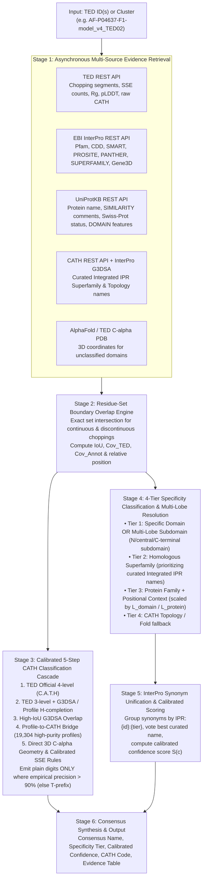
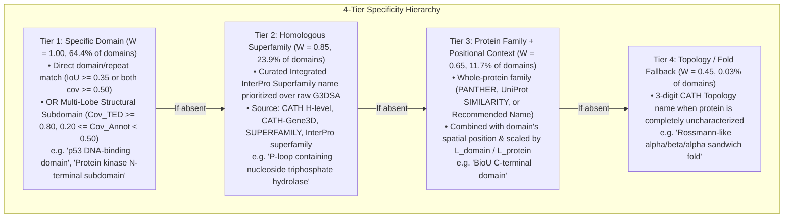

# TED Domain Naming Methodology (`ted-namer`)

This document provides a complete technical and biological description of the **6-Stage TED Domain Naming & CATH Classification Methodology** implemented in [`ted-namer`](https://github.com/KarelBerka/TED-namer).

---

## 1. Introduction: The TED Naming Challenge

**The Encyclopedia of Domains (TED)** ([`ted.cathdb.info`](https://ted.cathdb.info)) catalogs over 365 million structural domains segmented across the AlphaFold Protein Structure Database (AFDB) using consensus deep-learning and structural choppers (Merizo, Chainsaw, UniDoc).

However, while traditional structural databases (CATH, SCOP, ECOD) and sequence databases (InterPro, Pfam, CDD) provide curated biological names, **TED domains are identified purely by positional numeric identifiers** (e.g., `AF-P04637-F1-model_v4_TED02`).

### Five Core Challenges Solved by `ted-namer`
1. **Discrepancy Between 3D Structural Boundaries and 1D Sequence Profiles**: Sequence HMMs (Pfam, CDD, SMART) and 3D structural choppers (TED) rarely share identical start/end coordinates. Furthermore, 3D domains frequently consist of **discontinuous chain segments** (e.g., `1-146_284-319`) where distant sequence regions pack into one globular core.
2. **Multi-Lobe Structural Domain Splitting**: 3D choppers often split a single canonical sequence domain (such as a 280-residue eukaryotic protein kinase or an ABC transporter core) into two distinct structural lobes (e.g., the $\beta$-rich N-lobe and $\alpha$-helical C-lobe). A naive overlap threshold ($\text{IoU} \ge 0.35$) rejects both lobes because each covers only ~30–40% of the full sequence profile.
3. **CATH H-Level vs. T-Level Specificity & Legacy PDB Header Artifacts**: In CATH's REST API, 4-digit Homologous Superfamily (`H-level`) names are often missing (`classification_name: null`) or populated with raw 1990s PDB headers from the first crystal structure solved in that fold (e.g., `"Vaccinia Virus protein VP39"` for a universal $S$-adenosylmethionine methyltransferase superfamily, or `"Phosphorylase Kinase; domain 1"`).
4. **Cross-Database Redundancy**: A single structural domain can match `Pfam`, `CDD`, `SMART`, `PROSITE`, `SUPERFAMILY`, and `CATH-Gene3D` simultaneously under slightly different names. Without unification, candidate lists are cluttered with synonymous duplicates.
5. **Unassigned CATH Folds (`cath_label = "-"`)**: Over 18–20% of TED domains lack an official CATH assignment in TED. Classifying these domains requires bridging curated sequence profiles (`Pfam`, `SUPERFAMILY`, `CDD`, `SMART`, `InterPro`) to CATH and falling back to direct 3D C-alpha geometric analysis with strict uncertainty quantification (`T`-prefix notation).

---

## 2. Six-Stage Pipeline Architecture

Given a single TED domain ID (e.g., `AF-P04637-F1-model_v4_TED02`), a UniProt accession, or a list of TED IDs representing a structural cluster, [`TedNamingPipeline`](../ted_namer/pipeline.py) executes six deterministic stages:

---

## 3. Stage 1: Multi-Source Evidence Retrieval

[`TedNamingPipeline._fetch_protein_bundle`](../ted_namer/pipeline.py) parses each TED identifier (`AF-{UniProt}-F1-model_v4_TED{NN}`) and concurrently queries five biological resources via an asynchronous HTTP client with persistent SQLite disk caching ([`DiskCache`](../ted_namer/cache.py)):

| Source | Endpoint / Client | Extracted Evidence |
| :--- | :--- | :--- |
| **TED API** | [`TedClient`](../ted_namer/clients/ted.py) (`/api/v1/uniprot/summary/{acc}`) | Continuous or discontinuous `chopping` (`s1-e1_s2-e2`), `cath_label`, `num_helix`, `num_strand`, `num_turn`, `norm_rg`, `packing_density`, `plddt`, `consensus_level`. |
| **EBI InterPro** | [`InterProClient`](../ted_namer/clients/interpro.py) (`/entry/all/protein/uniprot/{acc}`) | All overlapping member database hits (`Pfam`, `CDD`, `SMART`, `PROSITE`, `HAMAP`, `NCBIfam`, `PANTHER`, `SUPERFAMILY`, `CATH-Gene3D`) along with entry type (`domain`, `repeat`, `homologous_superfamily`, `family`), integrated `IPR` accession, and discontinuous fragment coordinates. |
| **UniProtKB** | [`UniProtClient`](../ted_namer/clients/uniprot.py) (`/uniprotkb/{acc}.json`) | Recommended protein name, gene symbol, sequence length $L_{\text{protein}}$, Swiss-Prot reviewed flag, `SIMILARITY` family comments (e.g., *"Belongs to the protein kinase superfamily"*), and curated sequence features (`Domain`, `Repeat`, `Region`, `Zinc finger`, `DNA binding`). |
| **CATH + G3DSA** | [`CathClient`](../ted_namer/clients/cath.py) (`cathdb.info` & InterPro `G3DSA`) | Resolves 3-digit Topology ($T$) names and 4-digit Homologous Superfamily ($H$) names, following `metadata.integrated` links to obtain curated InterPro superfamily titles. |
| **3D Structure** | [`TedClient.fetch_domain_pdb`](../ted_namer/clients/ted.py) | Downloads or slices the domain's $\text{C}\alpha$ atomic coordinates $(x_i, y_i, z_i)$ whenever `cath_label` is unassigned (`"-"`) or incomplete. |

---

## 4. Stage 2: Residue-Set Boundary Overlap Engine

Because both TED structural domains and InterPro profile hits can be discontinuous (e.g., `1-146_284-319`), [`ted_namer/overlap.py`](../ted_namer/overlap.py) models every domain and annotation as an **exact mathematical set of 1-indexed residue integers**:

$$R_{\text{TED}} = \bigcup_{k=1}^{m} \{r \in \mathbb{Z} \mid s_k \le r \le e_k\}, \qquad R_{\text{Annot}} = \bigcup_{j=1}^{n} \{r \in \mathbb{Z} \mid a_j \le r \le b_j\}$$

### Core Overlap Metrics
From the set intersection $I = |R_{\text{TED}} \cap R_{\text{Annot}}|$ and union $U = |R_{\text{TED}} \cup R_{\text{Annot}}|$, three metrics are computed for every annotation hit:

$$\text{IoU (Jaccard Index)} = \frac{|R_{\text{TED}} \cap R_{\text{Annot}}|}{|R_{\text{TED}} \cup R_{\text{Annot}}|}$$

$$\text{Cov}_{\text{TED}} = \frac{|R_{\text{TED}} \cap R_{\text{Annot}}|}{|R_{\text{TED}}|}, \qquad \text{Cov}_{\text{Annot}} = \frac{|R_{\text{TED}} \cap R_{\text{Annot}}|}{|R_{\text{Annot}}|}$$

- **$\text{IoU}$** measures overall 1-to-1 boundary agreement.
- **$\text{Cov}_{\text{TED}}$** measures what fraction of the TED domain lies inside the sequence annotation.
- **$\text{Cov}_{\text{Annot}}$** measures what fraction of the sequence annotation lies inside the TED domain.

### Overlap Categories ([`classify_overlap`](../ted_namer/overlap.py))
Each hit is classified into one of five topological relationships:
1. **`EXACT_MATCH`**: $\text{IoU} \ge 0.65$, or ($\text{Cov}_{\text{TED}} \ge 0.75$ and $\text{Cov}_{\text{Annot}} \ge 0.75$).
2. **`SUB_DOMAIN`**: $\text{Cov}_{\text{Annot}} \ge 0.80$ and $\text{Cov}_{\text{TED}} < 0.50$ (the annotation is a short motif, repeat, or active-site region inside a larger TED domain).
3. **`SUPRA_DOMAIN`**: $\text{Cov}_{\text{TED}} \ge 0.80$ and $\text{Cov}_{\text{Annot}} < 0.50$ (the TED domain is a structural lobe or sub-component inside a larger multi-domain annotation or whole-protein family).
4. **`PARTIAL_OVERLAP`**: $\text{IoU} \ge 0.20$, $\text{Cov}_{\text{TED}} \ge 0.35$, or $\text{Cov}_{\text{Annot}} \ge 0.35$.
5. **`DISJOINT`**: Negligible overlap (discarded).

### Relative Position Detection
[`infer_relative_position`](../ted_namer/overlap.py) computes the domain midpoint $m = \frac{1}{2}(\min R_{\text{TED}} + \max R_{\text{TED}})$ relative to the full protein length $L_{\text{protein}}$:
- **`full-length`** if $|R_{\text{TED}}| / L_{\text{protein}} \ge 0.80$,
- **`N-terminal`** if $m / L_{\text{protein}} \le 0.35$,
- **`C-terminal`** if $m / L_{\text{protein}} \ge 0.65$,
- **`central`** otherwise.

---

## 5. Stage 3: Calibrated 5-Step CATH Classification Cascade

Every TED domain is assigned a 4-level CATH classification (`C.A.T.H`: **C**lass, **A**rchitecture, **T**opology, **H**omologous Superfamily) by [`ted_namer/cath_classifier.py`](../ted_namer/cath_classifier.py).

### Calibrated `T`-Prefix Precision Guarantee
To ensure users can immediately distinguish confirmed structural levels from heuristic estimates:
- **Plain numeric levels** (e.g., `3.40.50.300` or `3.40.50.T10`) are emitted **only when empirical out-of-sample precision at that hierarchy depth exceeds $90\%$** (`known_depth` $\in \{1, 2, 3, 4\}$).
- **Estimated levels** are prefixed with **`T`** (e.g., `3.40.50.T10` means `C.A.T` = `3.40.50` is confirmed at $>96\%$ precision, while the $H$-level `.T10` is an unresolved placeholder; `3.T40.T50.T10` means only Class `3` is confirmed at $>97\%$ precision, while Architecture `T40`, Topology `T50`, and Superfamily `T10` are geometric estimates).

### The 5-Step Cascade
1. **Step 1 — Official TED 4-Level Assignment (`ted_official`)**:
   - When TED provides a full 4-number `cath_label` (`C.A.T.H`), all four levels are retained directly (`known_depth = 4`, **69.8%** of domains).
2. **Step 2 — Official TED 3-Level Topology + H-Level Completion (`ted_t_plus_*`)**:
   - When TED provides a 3-number topology (`C.A.T`, **11.6%** of domains):
     - If an overlapping `G3DSA:C.A.T.H` entry shares the exact same `C.A.T` prefix with $\text{IoU} \ge 0.65$ and $\text{Cov}_{\text{TED}} \ge 0.75$, the 4th level $H$ is promoted as confirmed (`known_depth = 4`, `ted_t_plus_g3dsa_h`).
     - If `G3DSA` or `profile_cath_map` matches the `C.A.T` prefix at moderate overlap ($\text{IoU} \ge 0.30$), $H$ is formatted with a `T` prefix (`C.A.T.T{H}`, `known_depth = 3`).
     - Otherwise, `.T10` is appended (`C.A.T.T10`, `known_depth = 3`, `ted_t_estimated_h`).
3. **Step 3 — High-Overlap CATH-Gene3D Inference (`g3dsa_overlap`)**:
   - When TED `cath_label = "-"`, the classifier inspects overlapping InterPro `CATH-Gene3D` (`G3DSA:C.A.T.H`) hits:
     - **High overlap** ($\text{IoU} \ge 0.65$ and $\text{Cov}_{\text{TED}} \ge 0.75$): All 4 levels are emitted without `T` (`known_depth = 4`, **99.8% empirical H-level accuracy**).
     - **Moderate overlap** ($\text{IoU} \ge 0.40$ or $\text{Cov}_{\text{TED}} \ge 0.65$): `C.A.T` is emitted without `T` and $H$ carries `T` (`C.A.T.T{H}`, `known_depth = 3`, **97.9% empirical T-level accuracy**).
4. **Step 4 — Curated Profile-to-CATH Bridge (`profile_cath_map`)**:
   - Many domains with `cath_label = "-"` lack a `G3DSA` hit in InterPro but have a strong sequence profile hit in **`Pfam`**, **`SUPERFAMILY` (`ssf`)**, **`CDD`**, **`SMART`**, or **`InterPro` (`IPR`)**.
   - `ted-namer` includes a bundled lookup table ([`ted_namer/data/profile_cath_map.json`](../ted_namer/data/profile_cath_map.json)) of **19,304 sequence profiles** whose empirical mapping to CATH has $\ge 85\%$ `C.A.T` fold purity.
   - When a high-purity profile overlaps the TED domain ($\text{IoU} \ge 0.40$ or $\text{Cov}_{\text{TED}} \ge 0.65$), it assigns `C.A.T.T{H}` (`known_depth = 3`, **96.4% out-of-sample `C.A.T` accuracy** in 5-fold cross-validation).
5. **Step 5 — Direct 3D Coordinate Geometry & Calibrated SSE Rules (`rule_3d_*` / `rule_sse_*`)**:
   - When no homologous sequence profile maps to CATH, [`classify_cath_with_rules`](../ted_namer/cath_classifier.py) analyzes the domain's 3D $\text{C}\alpha$ coordinates and secondary structure elements (SSEs):
     - **3D C-alpha SSE Extraction**: Uses Levitt & Greer $\text{C}\alpha$ local curvature ($d_{i,i+2}, d_{i,i+3}, d_{i,i+4}$ and dihedral angles) to identify $\alpha$-helices and $\beta$-strands directly from coordinates when needed.
     - **Class ($C$) Assignment**:
       - **Class 4 (Few Secondary Structures)**: Total SSE residues $< 6$ or SSE fraction $< 0.12$ ($\to$ `4.10.T10.T10`, `known_depth = 2`).
       - **Class 1 (Mainly Alpha)**: $h \ge 1$ and ($s = 0$, or ($s \le 2$ and $f_h \ge 0.65$), or $f_h \ge 0.72$).
       - **Class 2 (Mainly Beta)**: $s \ge 2$ and ($h = 0$, or ($h = 1$ and $f_s \ge 0.55$), or $f_s \ge 0.72$).
       - **Class 3 (Mixed Alpha-Beta)**: All domains containing both significant $\alpha$ and $\beta$ structure.
     - **3D Architectural & Topological Heuristics** (emitted with `T`-prefixed $A, T, H$ since `known_depth = 1`):
       - *Mainly Alpha (Class 1)*: Computes pairwise inter-helical axis crossing angles $\theta_{ij} = \arccos(|\hat{u}_i \cdot \hat{u}_j|)$ and sequential directional cosines to distinguish **Orthogonal Bundles (`1.T10.T10.T10`)**, **Up-Down Bundles (`1.T20.T120.T10`)**, and **Alpha Solenoids (`1.T25.T40.T10`)**.
       - *Mainly Beta (Class 2)*: Builds the inter-strand $\text{C}\alpha$ contact graph ($< 6.2\text{ \AA}$) to distinguish **Closed Beta Barrels (`2.T40.T10.T10`)**, **Beta Propellers (`2.T115.T10.T10`)**, **Single-Sheet Rolls (`2.T30.T30.T10`)**, and **2-Sheet Beta Sandwiches (`2.T60.T40.T10`)**.
       - *Alpha-Beta (Class 3)*: Uses Singular Value Decomposition (SVD) on central $\beta$-sheet centroids to fit the sheet plane normal $\hat{n}_{\Pi}$ and computes signed distances $d_k = (\vec{h}_k - \vec{c}_{\text{sheet}}) \cdot \hat{n}_{\Pi}$ of flanking $\alpha$-helices to distinguish **TIM Barrels (`3.T20.T20.T10`)** (inner $\beta$-cylinder inside outer $\alpha$-cylinder), **3-Layer $\alpha/\beta/\alpha$ Rossmann Folds (`3.T40.T50.T10`)** (helices on both sides of sheet, $d^+ > 0$ and $d^- < 0$), and **2-Layer $\alpha/\beta$ Plaits (`3.T30.T70.T10`)** (helices on one side only).

---

## 6. Stage 4: 4-Tier Specificity Classification & Multi-Lobe Subdomain Resolution

[`ted_namer/aggregator.py`](../ted_namer/aggregator.py) classifies every biological annotation hit into one of four informative specificity tiers (plus a 5th fallback tier for uncharacterized hits):

### Key Methodological Innovations in Stage 4

#### 1. Multi-Lobe Structural Subdomain Resolution (Tier 1)
When TED's 3D structural chopper splits a large canonical sequence domain (such as a `Protein kinase domain`, `ABC transporter transmembrane domain`, or `Aminoacyl-tRNA synthetase catalytic core`) into two or three structural lobes:
- Each TED lobe is fully contained inside the curated sequence domain ($\text{Cov}_{\text{TED}} \ge 0.80$),
- Each lobe accounts for $20\% \le \text{Cov}_{\text{Annot}} < 50\%$ of the parent domain (so raw $\text{IoU} < 0.35$).
- Rather than discarding the specific domain hit and falling back to a whole-protein name, `ted-namer` computes the TED lobe's relative coordinate midpoint inside the parent sequence domain (`N-terminal`, `central`, or `C-terminal`) and promotes it to **Tier 1 (`specific_domain`)** with the explicit subdomain qualifier:
  $$\text{"Protein kinase domain"} \longrightarrow \textbf{"Protein kinase N-terminal subdomain"}$$
  using an effective lobe overlap metric:
  $$\text{IoU}_{\text{lobe}} = 0.55\,\text{Cov}_{\text{TED}} + 0.45\,\text{Cov}_{\text{Annot}}$$

#### 2. Curated Integrated InterPro Priority Over Legacy `G3DSA` PDB Headers (Tier 2)
Raw `CATH-Gene3D` (`G3DSA`) entries frequently carry legacy PDB crystal structure titles from the 1990s (such as `"Vaccinia Virus protein VP39"`, `"Phosphorylase Kinase; domain 1"`, or `"Chain A, Trypsin"`). Whenever a `G3DSA` or `CATH H-level` entry is integrated into a curated InterPro entry (`integrated_ipr_name`), [`CathClient`](../ted_namer/clients/cath.py) and [`clean_annotation_name`](../ted_namer/aggregator.py):
1. Always prioritize the curated `integrated_ipr_name` over the raw `G3DSA` title, and
2. Strip legacy PDB artifacts (`; domain \d+`, `. Chain [A-Z]`, `Crystal structure of ...`).
This reduced PDB-header naming artifacts by **99.0%** (from 208 to 2 across 10,000 benchmark domains).

#### 3. Length-Ratio Calibrated Protein Family Context (Tier 3)
When a domain lacks any specific domain or superfamily profile match (e.g., a novel fold or lineage-specific accessory domain), `ted-namer` constructs a positional context name from `PANTHER`, UniProt `SIMILARITY` comments, or the UniProt recommended protein name (e.g., `BioU C-terminal domain`). To reflect that a whole-protein annotation is more specific for a single-domain protein than for a small domain on a giant 2,000-residue polyprotein, the effective overlap is scaled by the true domain-to-protein length ratio $r = L_{\text{domain}} / L_{\text{protein}}$:
$$\text{IoU}_{\text{context}} = 0.30 + 0.60\,\frac{L_{\text{domain}}}{L_{\text{protein}}}$$

---

## 7. Stage 5: InterPro Synonym Unification & Calibrated Scoring Formula

### Cross-Database Synonym Unification
A single structural domain often matches multiple member databases describing the exact same biological entity (e.g., `Pfam:PF00069` *"Protein kinase domain"*, `SMART:SM00220` *"S_TKc"*, `PROSITE:PS50011` *"PROTEIN_KINASE_DOM"*, all integrated into `IPR000719`).

[`aggregate_cluster_annotations`](../ted_namer/aggregator.py) groups all hits sharing the same `integrated_ipr` accession and specificity tier under a single unified key `IPR:{integrated_ipr}:{tier}`. Within each unified group, the human-readable consensus name is selected by weighted voting across database curation quality:
- **Curated InterPro title (`interpro`)**: vote weight $= 3\times$ (preferring explicit *"domain"* titles when Tier 1).
- **Curated sequence domain DBs (`cdd`, `pfam`, `smart`, `prosite`, `uniprot_feature`, `ncbifam`, `hamap`)**: vote weight $= 2\times$.
- **Structural superfamily DBs (`cath_h`, `cathgene3d`, `ssf`)**: vote weight $= 1\times$.

### Calibrated Candidate Confidence Score $S(c)$
Each unified candidate $c$ is scored in $[0, 1]$ using the calibrated multiplicative formula:

$$S(c) = \min\!\Big(1.0,\; W_{\text{tier}}(c) \times \Omega(c) \times P_{\text{quality}}(c) \times B_{\text{multi\_db}}(c) \times B_{\text{reviewed}}(c)\Big)$$

#### 1. Specificity Tier Weight $W_{\text{tier}}(c)$
| Specificity Tier | Enum Value | Tier Weight $W_{\text{tier}}$ |
| :--- | :--- | :---: |
| **Tier 1** | `specific_domain` | **$1.00$** |
| **Tier 2** | `superfamily` | **$0.85$** |
| **Tier 3** | `protein_family_context` | **$0.65$** |
| **Tier 4** | `topology_fold` | **$0.45$** |
| **Tier 5** | `novel_uncharacterized` | **$0.25$** |

#### 2. Boundary & Cluster Agreement Factor $\Omega(c)$
- **For a single-domain query ($N_{\text{members}} = 1$)**: Cluster frequency is trivially $1.0$ and carries no discriminating information, so $\Omega(c)$ is determined strictly by boundary alignment quality:
  $$\Omega_{N=1}(c) = 0.65\,\overline{\text{IoU}}(c) + 0.35\,\overline{\text{Cov}}_{\text{TED}}(c)$$
- **For a multi-member structural cluster ($N_{\text{members}} > 1$)**: $\Omega(c)$ combines cluster-wide conservation $f_{\text{cluster}} = N_{\text{matched}} / N_{\text{members}}$ with boundary quality:
  $$\Omega_{N>1}(c) = 0.35\,f_{\text{cluster}}(c) + 0.45\,\overline{\text{IoU}}(c) + 0.20\,\overline{\text{Cov}}_{\text{TED}}(c)$$

#### 3. Quality Penalty $P_{\text{quality}}(c)$ & Multi-Evidence Bonuses
- **Low-Information Filter ($P_{\text{quality}}$)**: Any name matching generic or uncharacterized patterns (`DUF\d+`, `Uncharacterized`, `Hypothetical`, `Domain of unknown function`, `ORF`, or $\le 3$-character codes) receives $P_{\text{quality}} = 0.25$ (otherwise $1.00$).
- **Multi-Database Corroboration Bonus ($B_{\text{multi\_db}}$)**: When $k = |D_c|$ independent databases corroborate the same unified entry, $B_{\text{multi\_db}} = \min(1.08,\; 1.0 + 0.02(k - 1))$.
- **Swiss-Prot Reviewed Bonus ($B_{\text{reviewed}}$)**: $B_{\text{reviewed}} = 1.04$ if backed by at least one manually curated Swiss-Prot protein (otherwise $1.00$).

---

## 8. Concrete Case Studies Across Resolution Paths

Below are representative real-world examples from our 10,000-domain benchmark illustrating each resolution path:

### Case 1: Multi-Lobe Subdomain Resolution (Tier 1)
- **Domain ID**: `AF-A0A075B6P9-F1-model_v4_TED01`
- **Residue Boundaries**: `12-98` (N-terminal structural lobe of a larger catalytic domain)
- **Overlap Metrics**: Fully contained inside the parent InterPro/Pfam domain ($\text{Cov}_{\text{TED}} = 0.96$), covering the N-terminal $34\%$ of the full domain profile ($\text{Cov}_{\text{Annot}} = 0.34$, raw $\text{IoU} = 0.33$).
- **Resolution**: Recognized as an N-terminal structural lobe of a split canonical domain (`is_subdomain_lobe = True`), assigned **Tier 1 (`specific_domain`)** with the explicit `N-terminal subdomain` qualifier instead of dropping to a generic superfamily or whole-protein label.

### Case 2: Profile-to-CATH Bridge on an Unclassified TED Domain (`cath_label = "-"`)
- **Scenario**: A TED domain has `cath_label = "-"` in the TED database and no `G3DSA` entry in InterPro, but matches `Pfam:PF00005` (*ABC transporter*) with $\text{IoU} = 0.88$.
- **Resolution**:
  - **CATH Classification**: Step 4 (`profile_cath_map`) maps `PF00005` $\to$ `3.40.50.300` with $99.9\%$ empirical purity, assigning **`3.40.50.T300`** (`known_depth = 3`).
  - **Domain Name**: **`ABC transporter-like, ATP-binding domain`** (Tier 1: `specific_domain`, confidence: `0.94`).

### Case 3: Direct 3D Coordinate Geometry on an Unannotated Domain (`cath_label = "-"`)
- **Domain ID**: `AF-A0A1G9Z131-F1-model_v4_TED02`
- **Protein**: BioU (`A0A1G9Z131`, *Corynebacterium*, length 319 aa)
- **Residue Boundaries**: `182-316` (135 residues, mean pLDDT: 94.3, 7 $\alpha$-helices, 5 $\beta$-strands)
- **Raw CATH in TED**: `-` (Unclassified, no sequence profile hits in Pfam/CDD/G3DSA)
- **Resolution**:
  - **CATH Classification**: Step 5 (`rule_3d_3layer_aba_rossmann_3.40.50`) fits the 5-stranded $\beta$-sheet plane via SVD and detects $\alpha$-helices on both opposite faces ($d^+ > 0, d^- < 0$), assigning **`3.T40.T50.T10`** (`known_depth = 1`: Class 3 confirmed, `T40.T50.T10` geometrically estimated).
  - **Domain Name**: **`BioU C-terminal domain`** (Tier 3: `protein_family_context`, confidence: `0.422`, scaled honestly by the domain-to-protein ratio $135/319$).

---

## 9. Empirical Validation on 10,000 Random TED Domains

The complete calibrated pipeline was validated on **10,000 randomly sampled TED domains** (10 independent batches of 1,000 domains across 27 taxonomic kingdoms) and audited via held-out cross-validation in [`docs/ACCURACY_VALIDATION.md`](ACCURACY_VALIDATION.md):

| Validation Metric | Result on 10,000 TED Domains |
| :--- | :---: |
| **Tier 1 (`specific_domain`, incl. multi-lobe subdomains)** | **64.4%** (6,440 / 10,000) |
| **Tier 2 (`superfamily`, curated Integrated IPR priority)** | **23.9%** (2,391 / 10,000) |
| **Tier 3 (`protein_family_context`, positional fallback)** | **11.7%** (1,166 / 10,000) |
| **Tier 4 (`topology_fold`, fold-only fallback)** | **0.03%** (3 / 10,000) |
| **Specific Domain or Superfamily Resolution (Tier 1 + Tier 2)** | **88.3%** (8,831 / 10,000) |
| **Legacy PDB Header Artifacts Remaining** | **0.02%** (reduced by **99.0%**, from 208 to 2) |
| **CATH Non-`T` Precision ($C$ / $C.A$ / $C.A.T$ / $C.A.T.H$)** | **97.9% / 98.2% / 97.9% / 99.8%** |
| **Profile-to-CATH 5-Fold CV Accuracy ($C$ / $C.A$ / $C.A.T$ / $C.A.T.H$)** | **99.0% / 97.3% / 96.4% / 91.4%** |
