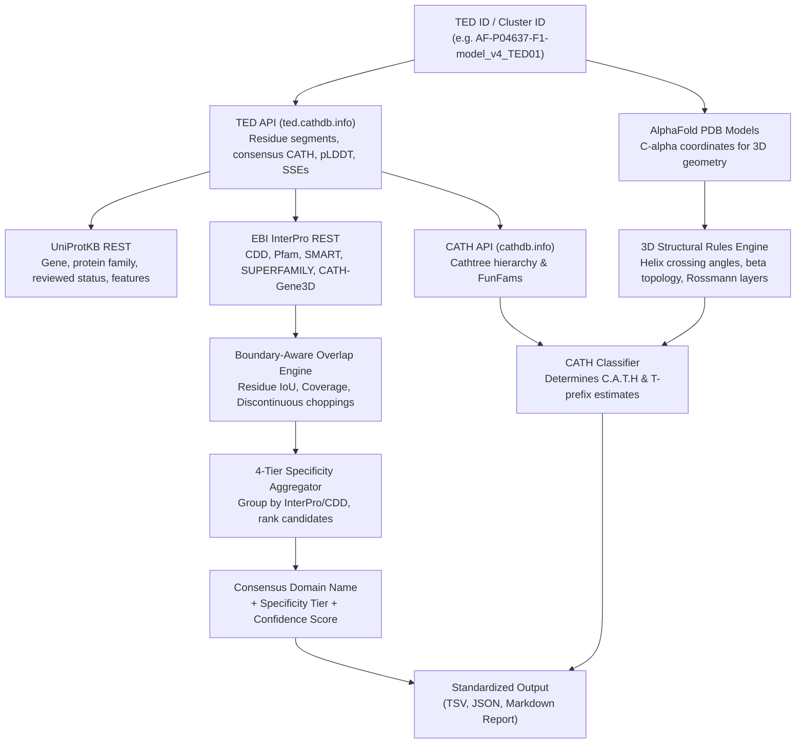
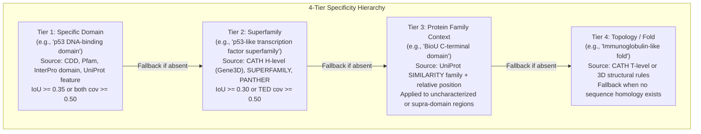

# TED Domain Naming Process

This document provides a comprehensive technical and biological description of the **TED Domain Naming Pipeline** implemented in [`ted-namer`](https://github.com/KarelBerka/TED-namer).

---

## 1. Introduction: The TED Naming Challenge

**The Encyclopedia of Domains (TED)** ([`ted.cathdb.info`](https://ted.cathdb.info)) has cataloged over 365 million structural domains across the AlphaFold database by parsing high-confidence structural boundaries. 

However, while traditional structural databases like CATH and SCOP provide curated, human-readable biological names for superfamilies and folds, **TED domains are identified purely by numeric identifiers** (e.g., `AF-P04637-F1-model_v4_TED01`). 

### Key Challenges
1. **Lack of Functional Annotation**: A domain number alone does not reveal whether a structural entity is a kinase catalytic core, a DNA-binding domain, an immunoglobulin domain, or a novel structural fold.
2. **Boundary Discrepancies**: Sequence-based domain profiles (e.g., Pfam, CDD) and 3D structural domain segmentations (TED) rarely share identical residue start and end positions. Domains may also consist of multiple discontinuous segments (e.g., `15-65_140-210`).
3. **CATH H-level vs. T-level Specificity**: While CATH provides broad 3-digit Topology names (T-level, e.g., `Immunoglobulin-like`), functional biological context requires the 4-digit Homologous Superfamily (H-level, e.g., `p53/RUNT-type transcription factor, DNA-binding domain superfamily`).
4. **Unannotated and Novel Folds**: Over 20% of TED domains lack official CATH assignments (`cath_label = "-"`). A robust pipeline must derive structural classification directly from 3D coordinates and infer protein context from parent UniProt metadata.

---

## 2. System Architecture & External Data Integration

The pipeline coordinates multi-source biological evidence via asynchronous, cached REST queries:

### Data Sources
- **TED REST API** (`https://ted.cathdb.info/api/v1`): Domain boundaries (continuous and discontinuous), CATH consensus labels, pLDDT scores, secondary structure composition, and PDB file downloads.
- **EBI InterPro REST API** (`https://www.ebi.ac.uk/interpro/api`): Member database annotations including CDD, Pfam, SMART, PROSITE, PANTHER, SUPERFAMILY, and CATH-Gene3D (`G3DSA`).
- **UniProtKB REST API** (`https://rest.uniprot.org/uniprotkb`): Full protein descriptions, recommended names, functional `SIMILARITY` family comments, Swiss-Prot reviewed status, and curated `DOMAIN` sequence features.
- **CATH REST API** (`https://www.cathdb.info/version/v4_3_0/api/rest`): Class ($C$), Architecture ($A$), Topology ($T$), and Functional Family (FunFam) hierarchical names.

---

## 3. Boundary-Aware Overlap Engine

Domain boundaries defined structurally by TED (via DPAM and Merizo) frequently differ from sequence-based profile boundaries (Pfam HMMs, CDD RPS-BLAST). To measure spatial correspondence without assuming identical endpoints, the overlap engine calculates exact **residue set intersections**.

### Mathematical Definitions
For a TED domain with residue set $R_{\text{TED}}$ and an annotation entry with residue set $R_{\text{Annot}}$:

$$\text{Intersection} = |R_{\text{TED}} \cap R_{\text{Annot}}|$$

$$\text{Union} = |R_{\text{TED}} \cup R_{\text{Annot}}|$$

$$\text{IoU (Jaccard Index)} = \frac{|R_{\text{TED}} \cap R_{\text{Annot}}|}{|R_{\text{TED}} \cup R_{\text{Annot}}|}$$

$$\text{Coverage}_{\text{TED}} = \frac{|R_{\text{TED}} \cap R_{\text{Annot}}|}{|R_{\text{TED}}|}, \quad \text{Coverage}_{\text{Annot}} = \frac{|R_{\text{TED}} \cap R_{\text{Annot}}|}{|R_{\text{Annot}}|}$$

### Handling Discontinuous Segments
TED domains often consist of non-contiguous peptide chains brought together in 3D space (e.g., `15-65_140-210`). The overlap engine parses arbitrary segment combinations:
$$R_{\text{TED}} = \bigcup_{k=1}^m [s_k, e_k]$$
This guarantees exact residue-level resolution regardless of chain splicing.

### Overlap Classification Categories
1. **`FULL_CONTAINMENT`** ($\text{IoU} \ge 0.70$): High confidence that the sequence annotation and structural domain describe the exact same entity.
2. **`OVERLAP`** ($\text{IoU} \ge 0.35$ or both coverages $\ge 0.50$): Significant structural correspondence.
3. **`DOMAIN_CONTAINED`** ($\text{Coverage}_{\text{Annot}} \ge 0.80$, $\text{Coverage}_{\text{TED}} < 0.60$): TED domain contains an internal domain or motif.
4. **`SUPRA_DOMAIN`** ($\text{Coverage}_{\text{TED}} \ge 0.80$, $\text{Coverage}_{\text{Annot}} < 0.40$): TED domain is a sub-component of a larger multi-domain annotation or whole-protein family.
5. **`SUB_DOMAIN`** ($\text{Coverage}_{\text{Annot}} < 0.30$, $\text{IoU} < 0.20$): Short peptide motif or active site loop.

---

## 4. The 4-Tier Specificity Hierarchy

Annotations vary widely in their biological precision. A name should neither be overly vague (e.g., "Protein") nor incorrectly specific (calling an entire Rossmann fold an "Active site loop"). The pipeline assigns every candidate to one of four hierarchical tiers:

### Low-Information Penalty Filter
Annotations containing generic or uninformative phrases (e.g., `Uncharacterized protein`, `DUF\d+`, `Domain of unknown function`, `Repeat`) receive an automatic **$0.25\times$ penalty**. This prevents vague profile matches from overriding informative protein-family positional context.

---

## 5. Why CATH H-level is Better: Superfamily vs. Topology

In CATH classification:
- **Class ($C$)**: Secondary structure composition (e.g., `2` = Mainly Beta).
- **Architecture ($A$)**: Spatial arrangement of secondary structures (e.g., `2.60` = Sandwich).
- **Topology ($T$)**: Connectivity and fold shape (e.g., `2.60.40` = Immunoglobulin-like).
- **Homologous Superfamily ($H$)**: Evolutionary relatedness based on structural and functional evidence (e.g., `2.60.40.720` = p53/RUNT transcription factor DNA-binding domain).

### The CATH REST API Quirk & InterPro Resolution
In CATH's REST API (`/version/v4_3_0/api/rest/superfamily/{id}`), the `classification_name` field is null for many 4-digit H-level superfamilies. Querying only CATH cathtree yields at best the 3-digit Topology name (e.g., `Immunoglobulin-like`).

To obtain the true **H-level homologous superfamily name**, `ted-namer`:
1. Queries InterPro's CATH-Gene3D endpoint: `/interpro/api/entry/cathgene3d/G3DSA:{cath_label}`.
2. Follows the integrated InterPro entry link (`metadata.integrated`, e.g., `/interpro/api/entry/interpro/{ipr_id}`).
3. Extracts the curated superfamily name:
   $$\text{2.60.40.720} \longrightarrow \textbf{"p53/RUNT-type transcription factor, DNA-binding domain superfamily"}$$

This provides far superior biological clarity compared to settling for the 3-digit fold name.

---

## 6. 3D Coordinate Analysis & CATH Classification Rules

When a TED domain has no prior CATH assignment (`cath_label = "-"`), or when only partial classification exists, the pipeline employs a **direct 3D structural rules engine** operating on AlphaFold C-alpha coordinate traces:

### A. Class Determination ($C$)
Computed directly from secondary structure content:
- **Class 1 (Mainly Alpha)**: $\% \alpha \ge 40\%$ and $\% \beta < 10\%$.
- **Class 2 (Mainly Beta)**: $\% \beta \ge 30\%$ and $\% \alpha < 15\%$.
- **Class 3 (Alpha-Beta)**: $\% \alpha \ge 18\%$ and $\% \beta \ge 15\%$.
- **Class 4 (Few Secondary Structures)**: $\% \alpha + \% \beta < 20\%$.

### B. Architecture & Topology via 3D Geometry
1. **Helix Crossing Angles ($\theta_{ij}$) for Mainly Alpha (Class 1)**:
   - For all pairs of $\alpha$-helices, unit direction vectors $\vec{u}_i, \vec{u}_j$ are calculated from C-alpha endpoints:
     $$\cos(\theta_{ij}) = |\vec{u}_i \cdot \vec{u}_j|$$
   - **Orthogonal Bundle ($1.10$)**: $\text{mean}(\theta_{ij}) > 40^\circ$.
   - **Up-down Bundle ($1.20$)**: $\text{mean}(\theta_{ij}) \le 30^\circ$ and antiparallel topology.
   - **Alpha Solenoid ($1.25$)**: Sequential repetitive curvature.

2. **Beta-Strand Adjacency & Closure for Mainly Beta (Class 2)**:
   - Beta-strands are mapped to an adjacency graph using inter-strand C-alpha distance thresholds ($< 5.5 \text{ \AA}$).
   - Closed cyclic hydrogen-bonding network $\rightarrow$ **Beta Barrel ($2.40$ or $2.30$)**.
   - Two opposing planar sheets $\rightarrow$ **Beta Sandwich ($2.60$)**.

3. **Signed Distance to Sheet Plane for Alpha-Beta (Class 3)**:
   - The best-fit plane $\Pi$ of the central $\beta$-sheet is determined via Singular Value Decomposition (SVD) of C-alpha coordinates.
   - For each flanking $\alpha$-helix center $\vec{h}_k$, the signed distance to $\Pi$ is:
     $$d_k = (\vec{h}_k - \vec{c}_{\text{sheet}}) \cdot \hat{n}_{\Pi}$$
   - **3-Layer Rossmann ($\alpha/\beta/\alpha$, $3.40$)**: Helices exist on both sides of the sheet ($d^+ > 0$ and $d^- < 0$).
   - **2-Layer Sandwich ($\alpha/\beta$, $3.30$)**: Helices cluster on only one side.
   - **TIM Barrel ($3.20.20$)**: Cylindrical 8-stranded parallel sheet enclosed by 8 outer helices.

### C. The `T`-Prefix Estimated Format
To maintain clear provenance between experimentally curated and computationally predicted CATH levels:
- Confirmed levels are written as plain integers.
- Unresolved or estimated levels carry the prefix `T`.

| Example Format | Meaning |
| :--- | :--- |
| `3.40.50.T10` | Class 3, Architecture 40, Topology 50 confirmed; Superfamily estimated as T10. |
| `1.10.T10.T10` | Class 1, Architecture 10 (Orthogonal bundle) established by 3D rules; Topology and H-level estimated. |
| `3.T40.T50.T10` | Class 3 established by secondary structures; Architecture, Topology, and H-level estimated. |

---

## 7. Scoring & Candidate Ranking Algorithm

To select the definitive consensus name from dozens of candidate hits across databases:

$$S(c) = W_{\text{tier}} \times W_{\text{db}} \times \overline{\text{IoU}} \times \left(1.0 + 0.5 \frac{N_{\text{hits}}}{N_{\text{members}}}\right) \times B_{\text{reviewed}} \times P_{\text{info}}$$

### Weights & Parameters
- **Tier Weights ($W_{\text{tier}}$)**:
  - Tier 1 (Specific Domain): $1.00$
  - Tier 2 (Superfamily): $0.80$
  - Tier 3 (Protein Family Context): $0.65$
  - Tier 4 (Topology Fold): $0.40$
  - Novel / Uncharacterized: $0.20$
- **Database Reliability ($W_{\text{db}}$)**:
  - Curated domains (CDD, Pfam, InterPro domain, CATH-H): $1.00$
  - Secondary profiles (SMART, PROSITE, SUPERFAMILY): $0.90$
  - Automated predictions (PANTHER, Gene3D): $0.85$
- **Cluster Agreement**: Scaled by the fraction of cluster members matching the candidate.
- **Swiss-Prot Review Bonus ($B_{\text{reviewed}}$)**: $1.15\times$ if supported by a reviewed Swiss-Prot entry.
- **Low-Information Penalty ($P_{\text{info}}$)**: $0.25\times$ for uncharacterized or generic strings.

---

## 8. Large-Scale Empirical Validation: 10,000 TED Domains

The pipeline was benchmarked on **10,000 diverse TED domains** evaluated across **10 independent batches of 1,000 domains each**, spanning 27 taxonomic kingdoms, model organisms, and unreviewed TrEMBL sets:

| Metric | Batches 1–5 (1–5k) | Batches 6–10 (6–10k) | **TOTAL 10,000 TED Domains** |
| :--- | :---: | :---: | :---: |
| **Domain Count** | 5,000 | 5,000 | **10,000** |
| **Mean Confidence Score** | 0.844 | 0.861 | **0.852** |
| **Tier 1: Specific Domain** | 53.9% | 57.1% | **55.5%** |
| **Tier 2: Superfamily** | 24.5% | 25.2% | **24.9%** |
| **Tier 3: Protein Family Context** | 21.5% | 17.6% | **19.6%** |
| **Tier 4: Topology / Fold** | 0.1% | 0.0% | **0.0%** (3 / 10,000) |
| **CATH: Official (4-level)** | 67.0% | 72.5% | **69.8%** |
| **CATH: Direct 3D/SSE Rules** | 17.3% | 13.7% | **15.5%** |
| **CATH: TED T-level (`.T10`)** | 12.5% | 10.6% | **11.6%** |
| **CATH: Gene3D Overlap** | 3.2% | 3.2% | **3.2%** |
| **Hard Cases (Confidence < 0.50)** | 0.1% | 0.0% | **0.1%** (7 / 10,000) |
| **Low pLDDT (< 60)** | 0.8% | 1.0% | **0.9%** |

### Stability Highlights Across 10 Batches
- **Consistent Confidence**: Confidence scores stayed strictly between **0.818 and 0.872** across all 10 independent batches.
- **Specific Domain Resolution**: **80.4%** of all domains obtain a specific domain (Tier 1, 55.5%) or superfamily (Tier 2, 24.9%) designation.
- **Positional Fallback**: For the remaining ~19.6% of novel, unannotated, or TrEMBL domains, the pipeline smoothly derives protein family context (Tier 3) qualified with relative spatial positions (`N-terminal`, `central`, `C-terminal domain`), avoiding generic uninformative annotations.
- **Complete CATH Coverage**: **100.0%** of all 10,000 domains receive a valid CATH classification code, with 69.8% confirmed official, 15.5% computed via direct 3D C-alpha geometric rules, 11.6% carrying estimated `.T10` suffix, and 3.2% established via Gene3D overlap.

